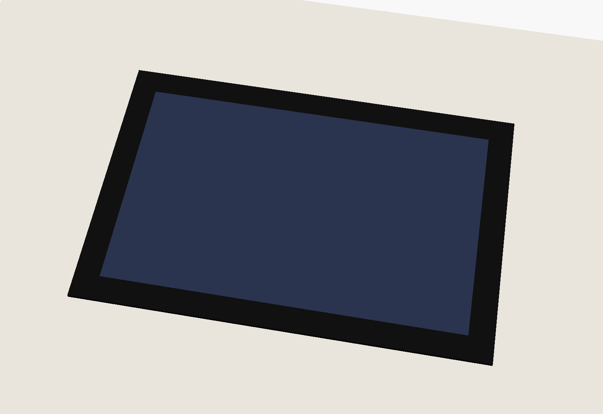
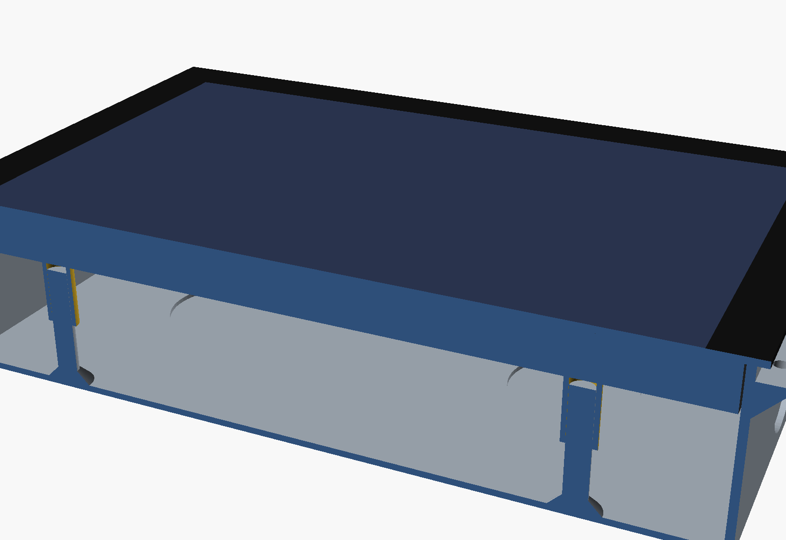

# Inbouwbak (fase 4)

Bak om de Raspberry Pi Touch Display 2 (10") **liggend in een stenen muur** te
bouwen. **Het glas ligt op de gestucte muur**, dus van voren zie je alleen het glas.
Ontworpen voor PLA en een printbed van 220 × 220 mm (Ender 3 V3), zonder support.

> **Status: ontwerp, nog niet geprint of gepast.** De maten van de behuizing en
> de bevestigingsgaten komen uit het voorbeeldontwerp (een flush mount voor een gipswand). Meet ze
> na aan je eigen scherm (stap 1). Alle maten staan bovenaan in
> [`hasioscherm-frame.scad`](hasioscherm-frame.scad); `./maak-stl.sh` maakt daarna
> STL's, afbeeldingen en mal opnieuw.

## Hoe het werkt

Dit volgt het principe van het voorbeeldontwerp (een flush mount voor een
gipswand), aangepast voor steen:

- Alleen de **behuizing** achter het glas (236,2 × 148,4 mm) gaat de muur in. Het
  **glas rust op het stucwerk**. Het steekt rondom 5,5 mm (links/rechts) en 8,8 mm
  (boven/onder) over de opening.
- De **bak** wordt ingegipst. Zijn voorrand ligt gelijk met het stucwerk en vormt
  zo de opening: strak en recht, ook als de steen ruw is uitgehakt. Het glas
  valt over de rand heen, dus de bak is niet te zien.
- Achter op het scherm schroef je **4 pegs** (afstandsbusjes) in de
  bevestigingsgaten (160 × 121,8 mm). Die schuiven over **4 paaltjes** in de bak
  en klemmen daar. Uitnemen doe je met een **zuignap**: recht naar voren trekken.
- De **Pi** zit gewoon achter op het scherm en komt er bij het uitnemen mee uit.
  Zorg voor wat lus in de netwerkkabel.
- **Koeling via de achter- of zijkant:** in de achterwand zitten twee gaten van
  40 mm, in de zijwanden en de boven- en onderwand gaten van 32 mm. Ze zijn
  dichtgeprint met een vlies van 0,6 mm. Druk alleen de gaten uit die je gebruikt,
  voor een luchtkanaal of de kabel. Waar het kanaal naartoe gaat, kies je zelf
  (zie *Warmte*).

## Benodigdheden

| Wat | Aantal | Opmerking |
|---|---|---|
| PLA | ± 220 g | 2 bakhelften + 4 pegs |
| Schroef M2.5 × 5 mm | 4 | pegs op het scherm (of de meegeleverde schroefjes) |
| Stukje filament 1,75 mm | ± 6 | paspennen tussen de helften (ca. 15 mm) |
| Lijm (secondelijm of 2K) | | helften verbinden |
| Snelgips / montagelijm | | bak in de muur zetten |
| Zuignap (tegel-/glaszuignap) | 1 | om het scherm uit te nemen |
| Officiële Active Cooler Pi 5 | 1 | blijft uit tot ±60 °C, dus stil; noodrem bij warmte |
| Klittenband | | USB-SSD in de bak vastzetten |

## Stappen

### 1. Meten (vóór het printen)
1. **Behuizing** achter het glas: breedte × hoogte → `behuizing_b`, `behuizing_h`
   (voorbeeld: 236,2 × 148,4).
2. **Glas**: buitenmaat en dikte → `glas_b`, `glas_h`, `glas_t`.
3. **Totale dikte** van het scherm → `scherm_d`.
4. **Bevestigingsgaten** achter op het scherm: hart-op-hart → `gat_x`, `gat_y`
   (voorbeeld: 160 × 121,8). Zit de Pi er niet tussen in de weg?
5. Pas ze aan in het `.scad`-bestand en draai `./maak-stl.sh`.

### 2. Printen

| Onderdeel | Bestand | Ligging | Support |
|---|---|---|---|
| Bak links/rechts | `stl/bak_*.stl` | achterwand op het bed | nee |
| Peg (4×) | `stl/peg.stl` | dichte kant op het bed | nee |

Instellingen: PLA, laag 0,2 mm, 3 wanden, 20 % infill. Pegs met 100 % infill.

### 3. Bak in elkaar
Steek stukjes filament als paspennen in de gaatjes op de naad, doe lijm op de
naad en druk de helften tegen elkaar. Doe dit op een vlakke ondergrond. Druk de
ventilatie- en kabelgaten uit die je wilt gebruiken.

### 4. Muur
1. Druk [`uitslijpmal.pdf`](uitslijpmal.pdf) af **op 100 %** en controleer de
   lijn van 100 mm. Plak de mal waterpas op de muur.
2. Hak de uitsparing uit: **262 × 174 mm, 58 mm diep** gerekend vanaf het
   afgewerkte stucwerk. Maak ook de doorvoer voor de netwerkkabel en eventueel
   het luchtkanaal.
3. Zet de bak in snelgips of montagelijm. **De voorrand moet precies gelijk
   liggen met het toekomstige stucwerk** en waterpas staan. Leg er een rechte
   lat over om dat te controleren. De flens rondom ligt 4 mm onder het
   oppervlak en geeft het stucwerk grip.
4. Stuc tot aan de voorrand van de bak. Plak de opening af, zodat er geen stuc
   in de bak komt.

### 5. Monteren
1. Schroef de 4 pegs achter op het scherm.
2. Schroef de Pi met de PoE-HAT en Active Cooler op het scherm en sluit de
   DSI-kabel en de voedingskabel aan. Zet de USB-SSD met klittenband vast.
3. Sluit de netwerkkabel aan en druk het scherm recht in de bak, tot het glas
   op de muur ligt.
4. Zit het te los, dan helpt een laagje tape om de paaltjes. Zit het te strak,
   schuur de paaltjes dan iets bij.

## Warmte
Er is geen ventilatie aan de voorkant, dus de warmte moet via de achter- of
zijkant weg. Mogelijkheden:
- een **kanaal** (bijv. een PVC-buis van 32 of 40 mm) vanuit een uitgedrukt gat
  naar een plek waar lucht kan stromen, zoals een plafond, plint, kast of de
  ruimte achter de muur. Een gat onderin en een gat bovenin geeft
  schoorsteenwerking;
- **alleen de muur**: de steen voert warmte af en de Active Cooler springt bij
  boven ±60 °C. Dat werkt waarschijnlijk, maar de bak wordt dan warmer.

PLA wordt rond 55–60 °C zacht. Houd de eerste weken in Home Assistant de
**CPU-temperatuur** en **Te warm** in de gaten. Wordt het te warm, print de bak
dan in PETG of ASA.

## Met dank aan
Het principe (opening ter grootte van de behuizing, glas op de wand, pegs over
paaltjes) komt uit het voorbeeldontwerp (een flush mount voor een gipswand). Dit is een eigen
uitwerking voor een stenen muur; de originele bestanden staan niet in deze repo.
